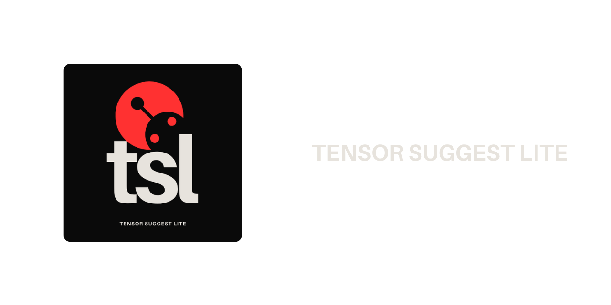

# TensorSuggestLite




[](https://github.com/core-red-project/tensorsuggestlite/actions/workflows/ci.yml)


[](https://discord.gg/h3hhNY8VTE)
[](https://patreon.com/SxnnysideProject)

<p align="center">
  <strong>Declarative ML ✦ Edge-Ready TFLite ✦ Zero-TensorFlow Inference</strong><br>
  <em>Transform configuration files into trained text classification models with instant edge deployment.</em>
</p>

<p align="center">
  <a href="#about">About</a> ✦
  <a href="#features">Features</a> ✦
  <a href="#installation--distribution">Installation</a> ✦
  <a href="#usage">Usage</a> ✦
  <a href="#architecture">Architecture</a> ✦
  <a href="#contributing">Contributing</a>
</p>

---

## About

**TensorSuggestLite** turns structured configuration files (JSON, YAML, TOML) into trained TensorFlow/Keras text classification models with automated TFLite export for embedded and edge environments.

Machine learning prototypes often suffer from repetitive boilerplate code for tokenization, label encoding, training loops, and quantization. TensorSuggestLite treats configuration directly as training data: declare categories and examples in standard structured formats, and the engine trains, profiles, evaluates, and converts the model into an optimized artifact ready for production.

The pipeline produces both a full Keras model for server workloads and a quantized TFLite binary that runs with sub-2ms latency on edge runtimes.

### Philosophy

> _"Configuration as training data."_

Part of the Core Red Project realm within the Sxnnyside Project ecosystem.

## Features

- **Declarative Multi-Format Input**: Direct parsing of JSON, YAML, and TOML datasets.
- **Dataset Profiling & Diagnostics**: Automated detection of class imbalance, duplicate sentences, and contradictory labeling prior to training.
- **Complete Artifact Bundle**: Exports `tokenizer.json`, `text_classifier.keras`, `label_encoder.json`, `text_classifier.tflite`, and rich `model_metadata.json`.
- **Confusion Matrix & Metrics**: Transparent training telemetry reporting F1-Score, Precision, Recall, Confusion Matrix, and tensor shapes.
- **Live Inference Playground**: Real-time cross-validation in GUI and CLI (`--compare`) verifying prediction parity between Keras and TFLite.
- **Zero-TensorFlow Lightweight Runtime**: Standalone inference engine (`lite_runtime.py`) executing predictions with ~5 MB dependencies and ~1 ms latency.
- **Dual Packaging**: Headless CLI for servers/containers alongside a native desktop GUI with dark/light themes.

## Installation & Distribution

TensorSuggestLite is distributed through three official channels:

### 1. PyPI Package (`pip install`)

Install via standard Python package managers:

```bash
# Lightweight CLI & LiteRT edge inference engine (~15 MB, zero TensorFlow)
pip install tensorsuggestlite

# With model training & TFLite conversion support (TensorFlow + Scikit-Learn)
pip install "tensorsuggestlite[train]"

# With native Desktop GUI support (DearPyGui)
pip install "tensorsuggestlite[gui]"

# Complete suite (CLI + Training + GUI)
pip install "tensorsuggestlite[full]"
```

### 2. Standalone CLI Binary (GitHub Releases)

Single-file self-contained executables with embedded runtime—no Python or system dependencies required:

| Architecture / Platform                   | Target Triple               | Download Archive                                           |
| ----------------------------------------- | --------------------------- | ---------------------------------------------------------- |
| **Debian ARM64 (Raspberry Pi OS 64-bit)** | `aarch64-unknown-linux-gnu` | `tensorsuggestlite-cli-*-aarch64-unknown-linux-gnu.tar.gz` |
| **Linux x86_64 (Ubuntu / Debian / RHEL)** | `x86_64-unknown-linux-gnu`  | `tensorsuggestlite-cli-*-x86_64-unknown-linux-gnu.tar.gz`  |
| **macOS Apple Silicon (M1/M2/M3/M4)**     | `aarch64-apple-darwin`      | `tensorsuggestlite-cli-*-aarch64-apple-darwin.tar.gz`      |
| **Windows x64**                           | `x86_64-pc-windows-msvc`    | `tensorsuggestlite-cli-*-x86_64-pc-windows-msvc.zip`       |

Download the archive for your architecture from [GitHub Releases](https://github.com/core-red-project/tensorsuggestlite/releases), extract, and copy `tensorsuggestlite-cli` to your `PATH` (e.g. `/usr/local/bin`).

### 3. Desktop GUI Application (GitHub Releases)

Standalone native desktop application:

- **macOS**: Drag-and-drop installer disk image (`tensorsuggestlite-gui-*-aarch64-apple-darwin.dmg`).
- **Windows**: Self-contained ZIP archive (`tensorsuggestlite-gui-*-x86_64-pc-windows-msvc.zip`).
- **Linux**: Compressed application tarball (`tensorsuggestlite-gui-*-x86_64-unknown-linux-gnu.tar.gz`).

### 4. Build From Source

```bash
git clone https://github.com/core-red-project/tensorsuggestlite.git
cd tensorsuggestlite

# Install dependencies and sync virtual environment
just install

# Run automated test suite
just test
```

## Usage

### Headless CLI

```bash
# Inspect and profile dataset integrity
uv run tensorsuggestlite inspect examples/example.json

# Train model headlessly with custom hyperparameters
uv run tensorsuggestlite train examples/example.json --output-dir generated/json --epochs 12 --learning-rate 0.001

# Convert Keras model to quantized TFLite
uv run tensorsuggestlite convert generated/json

# Run real-time prediction
uv run tensorsuggestlite predict generated/json "This product is fantastic!"

# Cross-validate Keras vs TFLite parity side-by-side
uv run tensorsuggestlite predict generated/json "Outstanding experience!" --compare

# Audit model registry and historical runs
uv run tensorsuggestlite history generated/json
```

### Desktop GUI Application

```bash
# Launch GUI in development mode
just dev
```

1. **Import**: Click **Import JSON/YAML/TOML** or drag & drop configuration files into the window.
2. **Profile**: Review dataset balance and sample counts in the console.
3. **Train**: Adjust hyperparameters (`Epochs`, `Learning Rate`, `Dropout`) and click **Train Model**.
4. **Convert & Export**: Click **Generate TFLite** and save the binary artifact.
5. **Playground**: Test sentences in real-time or click **Compare Keras vs TFLite** to verify quantization consistency.

### Standalone Zero-TensorFlow Inference

For edge deployment or resource-constrained microservices without full TensorFlow:

```bash
tensorsuggestlite predict generated/json "Can you help me solve this?" --tflite
```

## Architecture

```
tensorsuggestlite/
├── src/tensorsuggestlite/
│   ├── core/         # Domain entities, protocols, profiler & exceptions (MIT)
│   ├── cli/          # CLI commands, POSIX streams, manpage & suggestions (MIT)
│   ├── ml/           # Model training, TFLite export & zero-TF inference (MIT)
│   ├── parsers/      # Format parsers (JSON, YAML, TOML) & skeleton mapping (MIT)
│   ├── use_cases/    # Application workflows (Train, Export, Predict) (MIT)
│   └── ui/           # DearPyGui desktop graphical interface (MPL-2.0)
├── docs/             # Visual branding and ecosystem documentation assets
├── examples/         # Verified multi-format training fixtures (JSON, YAML, TOML)
├── tests/            # Automated test suite mirroring src/ (66 tests)
└── Justfile          # Canonical engineering task runner
```

> **Note on Drag & Drop:** Native OS drag-and-drop onto the application window is **Experimental** (verified on macOS via Cocoa/Metal; unsupported on Windows/Linux).

## Contributing

Contributions are accepted. See [CONTRIBUTING.md](CONTRIBUTING.md) for guidelines.

Before contributing, read the [Code of Conduct](CODE_OF_CONDUCT.md).

## License

This project is licensed under a split open-source model:

- **Core Engine & CLI (`core/`, `cli/`, `ml/`, `parsers/`, `use_cases/`, `main.py`)**: **MIT License** — see [LICENSE-MIT](LICENSE-MIT).
- **Desktop Graphical Interface (`ui/`)**: **Mozilla Public License Version 2.0 (MPL-2.0)** — see [LICENSE-MPL-2.0](LICENSE-MPL-2.0).

See the master [LICENSE](LICENSE) file for complete terms and the Artifact Ownership Notice.

## External Listings

- [AIBase — TensorSuggestLite](https://www.aibase.com/es/repos/project/tensorsuggestlite)

---

<p align="center">
  <strong>TensorSuggestLite</strong> — A Core Red Project<br>
  <em>&copy; 2026 Sxnnyside Project</em>
</p>
